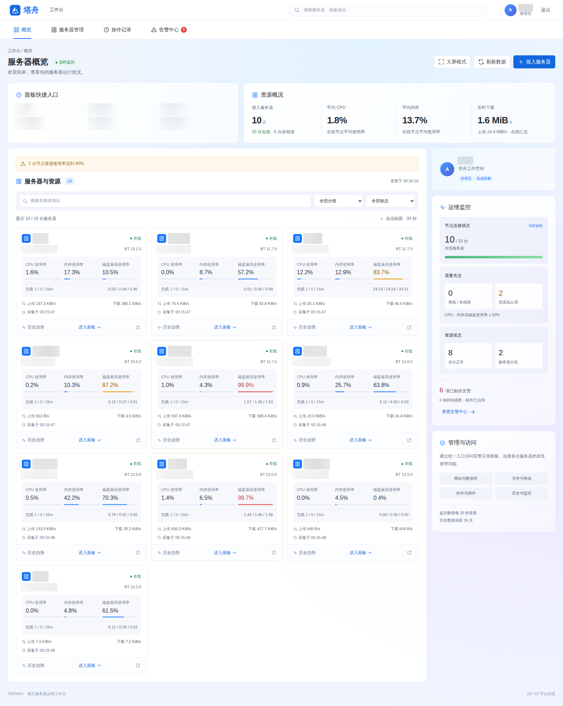
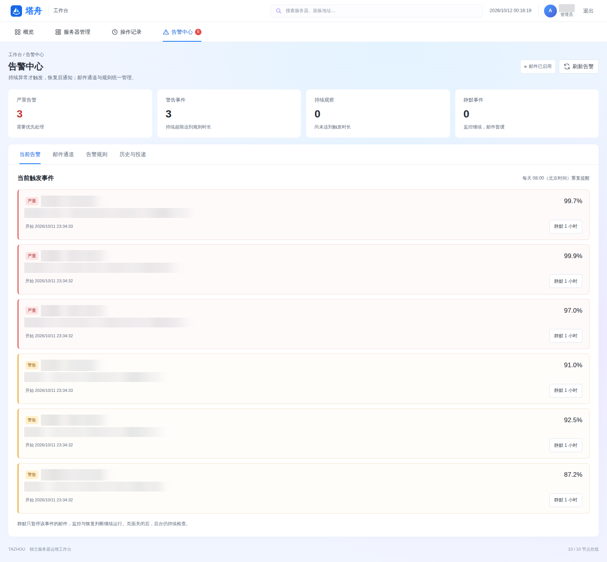
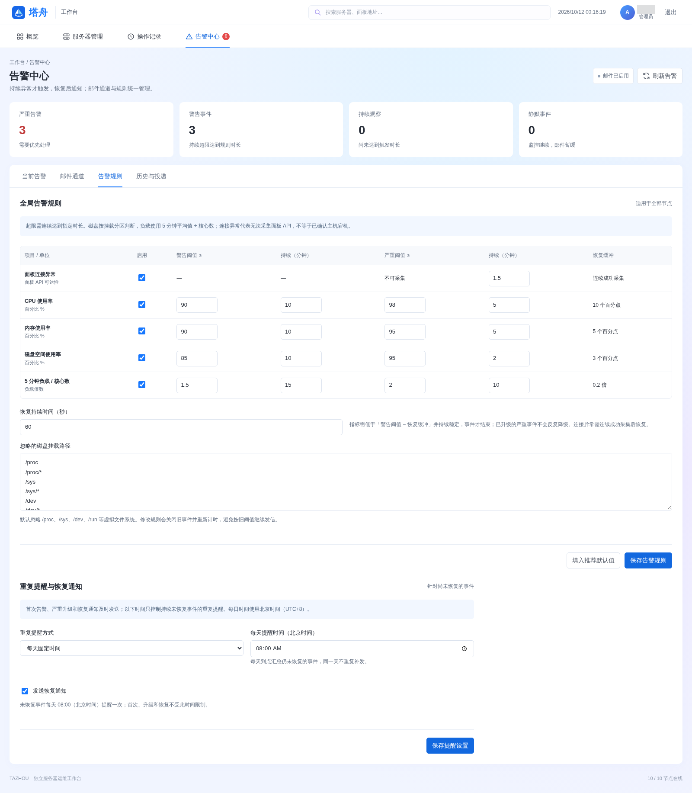

<p align="center">
  
</p>
<h1 align="center">塔舟 · Tazhou</h1>
<p align="center">多台服务器，一个工作台。</p>
<p align="center">An independent, self-hosted operations workspace for BT Panel.</p>
<p align="center">
  <a href="https://github.com/sea-with-sakura/baotaer/actions/workflows/tests.yml"></a>
  
  
</p>

塔舟是面向宝塔面板的独立、自托管运维工作台。一个入口查看服务器状态、进入完整面板，并接收掉线、恢复和资源告警。

> 本项目为独立第三方项目，与宝塔／堡塔官方无隶属或背书关系。「宝塔面板」「BT Panel」仅用于说明兼容对象。


## 功能

- **集中管理**：节点接入、分组、搜索、实时状态和历史趋势。
- **完整面板**：同域名路径代理、内嵌面板、原生临时授权免登录、WebSocket 与文件传输。
- **监控告警**：面板连接、CPU、内存、磁盘空间、负载；HTML 邮件、恢复通知、事件静默。
- **灵活提醒**：每隔 N 小时或每天指定北京时间重复提醒；掉线与恢复独立优先发送。
- **独立部署**：Python + SQLite，API 密钥与 SMTP 授权码加密存储，无需修改原宝塔面板。

## 界面预览



<details>
<summary>查看告警中心与提醒规则</summary>





</details>

## 宝塔官方项目

感谢宝塔提供面板与 API 能力。需要官方多服务器运维方案的用户，可以了解 **[堡塔云控](https://www.bt.cn/product/cloud-control/)**：官方产品提供多面板管理、大屏监控、分发管理、多用户管理等功能，具体功能、授权与支持以官网为准。

- [宝塔面板官网](https://www.bt.cn/) · [官方安装下载](https://www.bt.cn/new/download)
- [堡塔云控产品介绍](https://www.bt.cn/product/cloud-control/)
- [宝塔官方文档](https://docs.bt.cn/) · [面板 API 使用说明](https://docs.bt.cn/user-guide/config/common/panel-api)

## 快速部署

需要 Docker Engine 和 Docker Compose。

```bash
git clone https://github.com/sea-with-sakura/baotaer.git
cd baotaer
cp .env.example .env
```

修改 `.env` 中的访问入口，再启动：

```dotenv
BAOTAER_PUBLIC_ORIGIN=https://baota.example.com
BAOTAER_BIND_ADDRESS=127.0.0.1
BAOTAER_PORT=12500
```

```bash
docker compose up -d --build
docker compose exec baotaer cat /app/data/initial-login.txt
```

用户名为 `admin`，首次密码随机生成。将 Nginx、Caddy 或 Lucky 的 HTTPS 站点转发至 `http://127.0.0.1:12500`，启用 WebSocket、保留请求路径。新增节点不需要新增代理规则。

本机试用可使用默认配置访问 `http://127.0.0.1:12500`。需要直接从其他机器访问时，将绑定地址设为 `0.0.0.0`，同时把访问入口设为实际地址。反向代理若在另一个容器中运行，需要确保它能访问上游，不能直接使用该容器自己的 `127.0.0.1`。

> 访问入口必须与浏览器使用的地址一致，否则会影响登录 Cookie、CSRF 校验和面板导航。Docker 修改 `.env` 后，运行 `docker compose up -d` 生效。

## 开始使用

1. 在宝塔面板开启 API，允许塔舟服务器的实际出口 IP。
2. 在「服务器管理」添加面板地址、API 密钥和安全入口；支持原生临时授权的面板可启用免登录。
3. 在「告警中心 → 邮件通道」配置 SMTP，发送测试邮件并启用通知。
4. 在「告警规则」调整阈值；下方设置重复提醒方式和恢复通知。
5. 点击右上角「账号设置」修改管理员用户名与密码。需验证当前密码；新密码留空时只改用户名，修改成功后使用新账号重新登录。

连接异常默认持续 **90 秒**触发，连续成功采集 **60 秒**恢复。磁盘告警按挂载分区判断，监控的是空间占用。邮件首次触发、严重升级和恢复不等待重复提醒时间；默认未恢复事件每 **1 小时**提醒一次，每日模式使用北京时间（UTC+8）。

自签名 HTTPS 面板需要固定信任其叶证书：将 PEM 证书放入数据目录的 `certs/`，在节点设置填写服务可读取的绝对路径，例如 Docker 中的 `/app/data/certs/node.pem`。证书更新后需重新核实并替换文件。

## 非 Docker 部署

需要 Python 3.11+。

```bash
git clone https://github.com/sea-with-sakura/baotaer.git
cd baotaer
python3 -m venv .venv
.venv/bin/pip install -r requirements.txt
.venv/bin/python scripts/bootstrap.py --origin https://baota.example.com
.venv/bin/python -m app.server
```

初始化只创建自己的配置和数据库，重复执行不会覆盖已有数据。登录信息位于 `data/initial-login.txt`。`data/config.json` 可配置监听地址、端口、采集间隔和历史保留天数；修改后重启服务。也可使用 `BAOTAER_DATA` 指定数据目录、`BAOTAER_PUBLIC_ORIGIN` 覆盖公开入口。

长期运行可使用 [systemd 模板](deploy/baotaer.service)，默认安装路径为 `/opt/baotaer`、运行用户为 `baotaer`。项目放入该路径并安装依赖、初始化后执行：

```bash
sudo useradd --system --user-group --no-create-home baotaer
sudo chown -R baotaer:baotaer /opt/baotaer
sudo install -m 644 deploy/baotaer.service /etc/systemd/system/baotaer.service
sudo systemctl daemon-reload
sudo systemctl enable --now baotaer
```

使用其他路径或用户时，先修改模板中的对应字段。

## 运维

| 操作 | Docker Compose | Python / systemd |
| --- | --- | --- |
| 查看日志 | `docker compose logs -f baotaer` | `sudo journalctl -u baotaer -f` |
| 修改登录密码 | `docker compose exec baotaer python scripts/password.py`，然后重启容器 | `.venv/bin/python scripts/password.py`，然后重启服务 |
| 数据备份 | `docker compose exec baotaer python scripts/backup.py` | `.venv/bin/python scripts/backup.py` |
| 重启 | `docker compose restart baotaer` | `sudo systemctl restart baotaer` |

Docker 使用命名卷保存数据与备份，备份可用 `docker compose cp baotaer:/app/backups ./backups` 导出。Python 部署的备份默认写入 `backups/`，可用 `BAOTAER_BACKUPS` 指定位置。工具需以有权访问数据目录的用户运行。

恢复时先停止服务，将备份内容解包到数据目录，恢复目录属主和私有访问权限后再启动。务必同时保留 `cloud.db`、`config.json`、`encryption.key` 和 `certs/`；丢失加密密钥将无法解密节点密钥与 SMTP 授权码。Docker 不要使用 `docker compose down -v`，该操作会删除数据卷。

升级：

```bash
git pull --ff-only
docker compose up -d --build
```

Python 部署升级后重新安装 `requirements.txt` 并重启服务。升级前建议备份数据。

## 开发与限制

```bash
python -m unittest discover -s tests -v
```

测试使用临时数据库和本机模拟服务，不访问实际节点或发送外部邮件。GitHub Actions 在 Python 3.11、3.13 上运行测试。

目前为单管理员平台，仅提供 SMTP 通知。所有已接入面板及插件需可信：同域名代理不提供独立浏览器来源隔离。宝塔或插件升级后可能需要适配路径代理。连接异常表示面板 API 不可达，不等于已确认主机宕机；SMTP 接受邮件也不代表已送达收件箱。


## 致谢与参考资料

感谢以下项目与文档提供的接口说明、设计参考和基础能力：

| 项目 / 文档 | 使用与参考范围 |
| --- | --- |
| [宝塔面板 API](https://docs.bt.cn/api/)与[面板 API 使用说明](https://docs.bt.cn/user-guide/config/common/panel-api) | 节点接入、请求签名与接口对接；兼容行为结合面板源码和实际版本验证 |
| [Prometheus 告警规则](https://prometheus.io/docs/prometheus/latest/configuration/alerting_rules/)、[Alertmanager 配置](https://prometheus.io/docs/alerting/latest/configuration/)与 [node_exporter 官方规则](https://github.com/prometheus/node_exporter/blob/master/docs/node-mixin/alerts/alerts.libsonnet) | 持续触发、恢复、重复提醒和资源监控设计参考 |
| [Google SRE：Monitoring Distributed Systems](https://sre.google/sre-book/monitoring-distributed-systems/) | 监控信号与减少无效告警的设计原则 |
| [UI UX Pro Max](https://github.com/nextlevelbuilder/ui-ux-pro-max-skill) | 界面设计、响应式布局与交互参考 |
| [aiohttp](https://docs.aiohttp.org/en/stable/) | HTTP 服务、异步采集与 WebSocket 代理 |
| [cryptography / Fernet](https://cryptography.io/en/latest/fernet/) | API 密钥与 SMTP 授权码加密 |
| [Python smtplib](https://docs.python.org/3/library/smtplib.html)与 [email](https://docs.python.org/3/library/email.html) | SMTP 投递与 HTML / 纯文本 MIME 邮件 |

Prometheus、Alertmanager 和 node_exporter 仅作为设计参考，不是部署依赖；默认阈值为塔舟自行选定的初始策略。各项目名称与标志归其各自权利人所有。
